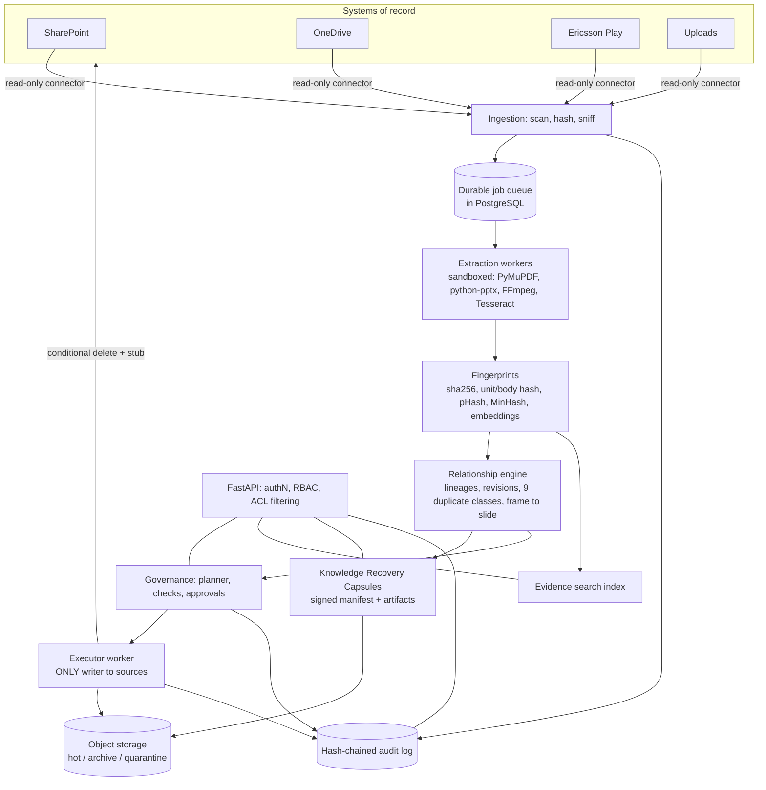

# Architecture

Principle: the original systems remain the systems of record. KORA is the
intelligence, optimisation and governance layer, and it does not become a
second copy of everything (`KORA_RETAIN_ORIGINALS=false`).

## Modules (modular monolith, async workers)

| Module | Responsibility |
|---|---|
| `connectors/` | `SourceConnector` (read-only) vs `ActionConnector` (narrow, conditional, idempotent writes) |
| `pipeline.py` | stage handlers: scan → hash → extract → relate → capsule / index → optimize (auto, policy-switchable) |
| `extraction/` | sandbox-side parsers: PDF pages, PPTX slides, video keyframes/audio/OCR, VTT/SRT |
| `fingerprint/` | pHash, MinHash + LSH, text normalisation, offline embedder |
| `versioning/` | revision schemes, file-name parsing, doc numbers, lineages, slide diff, reconstruction |
| `dedup/` | taxonomy and relationship engine |
| `media/framematch.py` | keyframe to slide linking, presented-document voting |
| `capsule/` | capsule builder (signed) and validator |
| `governance/` | policy-as-code, survivor ranking, checks, planner, executor, departure |
| `search/` | BM25 over a relational inverted index plus embedding rerank, ACL and version aware |
| `optimization/` | compression engine: sandbox renders + measures (SSIM, OCR readability, page text), parent judges against the policy budget; `REPLACE_WITH_RENDITION` plans in `governance/` |
| `jobs/` | durable queue and worker; `ctx.keepalive()` renews the lease from a side thread during long transcodes/ASR, and fenced completion still refuses a job whose lease was lost |
| `audit.py` | append-only chain with HMAC |
| `storage/` | content-addressed tiered blobs (local FS / S3), optional AES-GCM |
| `security/` | API keys and roles, ACL expansion, file-type sniffing and zip guards, sandbox |

## Reliability

* **Transactional outbox.** Jobs live in the same database and are enqueued in the same
  transaction as the domain change that causes them. A handler's writes, its follow-up
  jobs and its own completion commit atomically, so there is no lost or phantom work.
  This is a deliberate change from the Celery/Redis option in the original sketch: a
  separate broker introduces dual writes. Celery can sit behind the same interface for
  fan-out later.
* **At-least-once delivery with idempotent handlers.** Content-addressed blobs, upserts,
  unique constraints, and idempotency keys such as `extract:{sha}:v{n}` mean N copies of a
  file trigger one extraction.
* **Leases with fencing tokens.** A crashed worker's job is re-claimed after its lease
  expires. A zombie worker cannot complete a job it no longer owns (tested). Heartbeats
  extend long leases.
* **Retries** use exponential backoff with jitter, then a dead-letter state with
  `POST /v1/jobs/{id}/retry`.
* **PostgreSQL** uses `FOR UPDATE SKIP LOCKED` for claiming and row locks for invariants
  (lineage ordering, audit head, plan state, content during deletion). SQLite uses WAL
  with `BEGIN IMMEDIATE`. Both are tested end to end.
* **Blobs.** Writes are temp-file + fsync + atomic rename. Every read is verified against
  its address. Encryption is chunked so multi-GB files stream.
* **Deletion and compression are sagas** of idempotent steps, resumable after a crash, with
  re-checks before every destructive step. In-place replacement is conditional on the
  current bytes (compare-and-swap on SHA-256), so an edit made after approval is never overwritten.
* **Sandbox protocol channel.** The sandbox replies on a private dup of stdout and points fd 1
  at stderr, so native libraries that print warnings (MuPDF did, on Ericsson's C2L deck)
  cannot corrupt the reply.
* **Optimistic concurrency.** `row_version` on files and plans; `expected_version` on
  approvals.

## Security

* **Authentication**: random API keys; only SHA-256 hashes are stored. Departed
  principals are refused.
* **Roles**: viewer, analyst, approver, operator, auditor, admin. Separation of duties:
  the plan creator cannot approve, approvers are distinct, and only operators execute.
* **Data access**: search, lineages, capsules and blobs are filtered by the source ACLs.
  Once an original is gone, the capsule's ACL snapshot governs.
* **Least privilege at runtime**: ingestion workers mount sources read-only. Only the
  executor worker can write, and only with conditional operations (`docker-compose.yml`).
* **Untrusted files**:
  * type is detected from magic bytes, never from the extension; mismatches are rejected
  * zip-bomb, path-traversal and entry-count guards for OOXML
  * parsers run in a subprocess with a scrubbed environment (no DB URL or keys), rlimits
    on memory, CPU, file size and descriptors, and a wall-clock timeout that kills the
    process group
  * FFmpeg runs with `-protocol_whitelist file` so crafted playlists cannot fetch URLs
  * Pillow has a decompression-bomb limit
* **Paths**: connectors resolve paths inside the root and never follow symlinks. Blob
  keys must be 64 hex characters.
* **Integrity**: capsules carry an HMAC signature. The audit log is hash-chained and each
  event is MAC'd with a key the database never sees. Edits, reordering and truncation
  are detected (tested).
* **Secrets**: provided via environment or KMS in production, and required when
  `KORA_ENV=production`. Dev keys are generated with 0600 permissions.
* **HTTP**: no stack traces in errors, request ids, `nosniff`, `DENY` framing, `no-store`,
  CSP, and bounded uploads.

## Scaling path

| Now | Next |
|---|---|
| DB queue | Celery/Kafka for fan-out; keep the outbox for state transitions |
| relational inverted index | OpenSearch or Postgres FTS + pgvector HNSW |
| numpy pHash scan | BK-tree / multi-index hashing for >10⁶ slides |
| embedding scan | ANN index |
| filesystem connector | Microsoft Graph (delta queries, `quickXorHash`, `If-Match` eTags), Ericsson Play API |
| one process type per role | split services along the module boundaries above |
