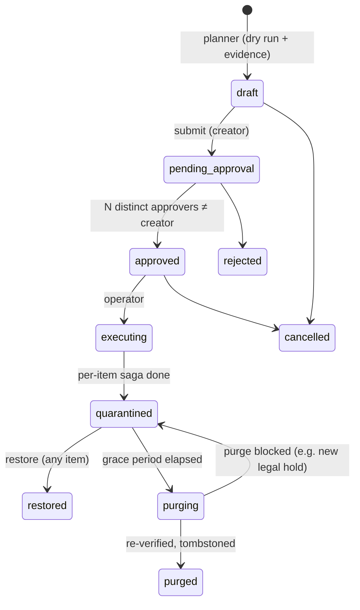

# Duplicate strategies and governed deletion

KORA never answers "is this a duplicate?" with one hash. It classifies *how* two
things are the same, because that decides what can safely be removed and what
"recovering it later" means. Deletion is then a governed, evidence-carrying,
reversible process rather than an `rm`.

## 1. The taxonomy

| Class | What it means | Detected by | Candidate generation (never O(n²)) | Action | Recovery after deletion | Approvals |
|---|---|---|---|---|---|---|
| `EXACT_COPY` | identical bytes in another place ("…(1).pdf", copies in OneDrive) | SHA-256 of the full stream | files sharing `files.sha256` | quarantine + stub | **byte-exact** from the survivor | 1 |
| `CONTAINER_VARIANT` | same rendered content, different bytes (re-saved, linearised, metadata changed) | ordered list of per-page `unit_hash` equal → `contents.normalized_hash` | index on `normalized_hash` | quarantine + stub | **render-equivalent** from the survivor | 1 |
| `SUPERSEDED_REVISION` | an older revision of a document family | lineage order + retention rule (see VERSIONING.md) | lineage table | compact to slide store | **render-equivalent**, rebuilt from slide store and *proven* | 1 |
| `CONTAINED_SUBSET` | an excerpt: every slide exists in a larger deck | per-slide `body_hash` containment = 100 % | index on `units.body_hash` | compact to slide store | **render-equivalent**, proven | 2 |
| `MEDIA_VARIANT` | same recording on two platforms, re-encoded | duration ± 2 % and temporal pHash signature (10 points) mean distance ≤ 10 | duration-range query | quarantine + stub (lower quality copy) | **media-equivalent** (survivor quality ≥ victim) | 2 |
| `RECORDING_DISTILLED` | recording whose knowledge capsule is validated | capsule validator (transcript coverage, keyframes, signature, artifacts) | per video | original → **archive tier** (policy can allow knowledge-only) | **byte-exact from archive** | 2 |
| `COMPRESSED` | a survivor that is far bigger than it needs to be (screen recordings at 30 fps / 1.8 Mbps, 300-dpi photos in slide PDFs) | compression engine: rendition produced in the sandbox, then **measured** against the policy's quality budget | per content, after dedup (only survivors) | **replace in place** with the rendition: same path, same name, still opens | original **byte-exact from quarantine** during grace; afterwards the budget-verified rendition | 2 |
| `PARTIAL_OVERLAP` | decks sharing some slides (80 % shared, 20 % unique) | shared `body_hash` ratio ≥ 0.2 | `body_hash` index | **never deleted**; shared slides stored once in the slide store | – | – |
| `NEAR_DUPLICATE` | same words, no identical slides (re-typed deck) | MinHash Jaccard ≥ 0.80 on body text | MinHash LSH, 32 bands × 4 rows | **never deleted**; human review | – | – |
| `KNOWLEDGE_OVERLAP` | same topic/facts, different material | embedding cosine ≥ 0.80 | embedding scan (ANN in prod) | **never deleted**; linked for search | – | – |

Structural edges stored in the same graph: `REVISION_OF` (with slide diff) and
`PRESENTED_IN` (a recording shows document *X*, revision *R*).

### Why slide identity has two hashes
Ericsson-style decks print the document number and page number in every footer.
Remove one slide and every later page renders differently, so byte- or
render-identity alone would say revision B shares only 1 page with revision A.

* `unit_hash` = sha256(72-dpi raster ‖ text): exact identity, used for the slide
  store and for recovery proofs.
* `body_hash` = same, with the bottom footer band excluded: used for matching,
  overlap, subset detection and diffs.

Measured on the samples: B vs A share **1** identical page but **7** identical
bodies; the 5G deck shares **0** identical pages but **6** bodies with A.

## 2. Choosing the survivor (canonical copy)

Deterministic ranking, recorded in the evidence report:

1. system-of-record precedence from policy (`sharepoint 3 > ericsson_play 2 > onedrive 1 > upload 0`)
2. owner is active (not departing/departed)
3. stronger retention governance (`record > regulatory > standard > transient`)
4. broader active audience (or "everyone")
5. original name (no "(1)", "Copy of", "- Copy")
6. earliest creation (the original upload, not a download)
7. stable id tie-break

For media, quality (height, bitrate) is ranked first; for subsets, a superset
containing every slide *byte-identically* wins over body-only matches. Only
active files in approved repositories can survive.

## 3. Proof-carrying deletion: the checks

Every item carries a list of checks. **Hard** checks are gates; the readiness
score (weighted pass rate, capped at 50 when any hard check fails) explains
confidence and never replaces approval.

| Check | Hard | Applies to | Meaning |
|---|---|---|---|
| `class_allowed` | ✔ | all | policy allows deleting this class with this action |
| `victim_unchanged` | ✔ | all | DB state still matches the planned hash; not pending re-hash |
| `legal_hold_clear` | ✔ | all | no legal hold (re-checked at purge: a hold can arrive during grace) |
| `retention_satisfied` | ✔ | all | label not immutable, minimum age reached (or survivor retains equal/stronger label for exact/variant copies) |
| `no_conflicting_plan` | ✔ | all | file is not victim/survivor in another open plan |
| `survivor_verified` | ✔ | copy classes | survivor active, hash matches, live eTag unchanged at execution |
| `permission_coverage` | ✔ | copy classes | every *active* reader of the victim can read the survivor (departing owner excluded) |
| `not_last_copy` | ✔ | exact/variant | ≥ `min_verified_copies` live copies remain that no open plan intends to delete |
| `recovery_path_verified` | ✔ | variant, revision, subset, recording | render-identical survivor / rebuild-and-re-render proof / archive copy hash-verified |
| `lineage_consistent` | ✔ | revision | no revision conflict, ordering confidence ≥ policy minimum, not the head, head has a live copy |
| `quality_budget` | ✔ | media | survivor resolution and bitrate ≥ victim, same duration |
| `capsule_valid`, `transcript_coverage` | ✔ | recording | signed, intact capsule; cues span ≥ 85 % with no long untranscribed gap |
| `quality_budget` | ✔ | compressed | every measured budget check passed (see §3a) |
| `lossy_allowed` | ✔ | compressed | content class permits lossy re-encoding (engineering diagrams never) |
| `rendition_intact` | ✔ | compressed | rendition blob exists and re-hashes to its key (plan + execute) |
| `net_saving` | ✔ | compressed, revision, subset | frees at least the policy minimum (20 % for compression, 10 % for compaction) |
| `speaker_attribution`, `keyframe_coverage` | – | recording | lower confidence, flagged as uncertain |
| `metadata_preserved`, `ownership_resolved` | – | copies, departure | provenance and new owner recorded |

Checks run **three times**: at plan creation (dry run), immediately before
quarantine, and immediately before purge.

### 3a. The compression quality budget (measured, not assumed)

The sandbox produces the rendition **and measures it**; the parent compares the
measurements with `policies/default.json → compression`. A rendition that misses
any line is stored as a failed measurement and is never offered for approval.

| Operation | What is changed | Budget (all must hold) |
|---|---|---|
| `video.transcode` | H.264 CRF 28, frame rate capped at 15 fps (slides do not move), mono AAC 64 kbps, `+faststart` | duration within 1 s · speech track present · SSIM ≥ 0.95 (1 frame/s, ffmpeg) · **slide text still readable: OCR of the rendition at every keyframe recovers ≥ 90 % of the words OCR found in the original** · ≥ 20 % smaller |
| `pdf.recompress` | only embedded images above 200 dpi *as placed on the page*, downsampled to 150 dpi, JPEG q80; masks, CMYK, palette, inverted images untouched; everything else byte-identical | same page count · **every page's text identical** · every page mean-SSIM (7×7 windows) ≥ 0.97 rendered at 144 dpi · ≥ 20 % smaller |

**Per-page fallback.** If any page drifts below the floor, the images on that page
are restored to their original bytes and the PDF is rebuilt (up to 3 rounds). On
Ericsson's 8.8 MB deck this kept 2 images original and still saved 30 %.

**Saga for `REPLACE_WITH_RENDITION`.** Steps 1–3 as below (original copied to
quarantine and hash-verified). Step 4 is a *conditional in-place swap*: the
connector re-hashes the file and writes the rendition (temp file + fsync + atomic
rename) only if the bytes are still the approved original. The file row then points
at the rendition, and re-extraction runs; a transcoded recording inherits the
original's transcript and its provenance (an `asr:*` transcript still needs review).
Restore swaps the original back, again only over the approved rendition. Purge
deletes the quarantined original and releases KORA's hot copy of the rendition; the
file itself is never removed. A rendition is never compressed again.

## 4. The lifecycle

Per-item saga (each step idempotent; the job queue resumes it after a crash):

1. lock the content row; **re-evaluate every hard check**; live eTag check of victim and survivor
2. record intent (`quarantining`) in the audit log
3. copy victim bytes to the quarantine tier (archive tier for recordings), verify SHA-256
4. **conditional removal** at the source: the action connector re-hashes and removes only if
   the bytes still equal the planned hash, leaving a `.kora-stub.json` pointer to the
   canonical copy (SharePoint: `If-Match` eTag)
5. mark item and file `quarantined`, audit

Purge re-checks (hold, retention, survivor, slide-store pages), deletes the
quarantine blob only when no other open item references the same content, and
leaves a **tombstone**: the stub (annotated `purged_at`), the DB row and an audit
event containing path, hash, size, class, recovery class, survivor, plan and
policy hash. Nothing disappears silently.

## 5. Invariants this enforces

* **Never delete the last copy.** Survivors are pinned; victims are reserved.
  Two plans can never each delete the other's survivor (tested).
* **No time-of-check/time-of-use gap.** A file edited after approval is not removed (tested).
* **Deduplication never revokes access.** A copy shared with an external partner whose
  canonical copy he cannot read stays (tested: `frank`).
* **Approvals bind to evidence.** Each approval stores the evidence hash; execution
  refuses if they differ. The creator cannot approve; each approver counts once.
* **Every deletion is reversible for the grace period** (policy: 30 days) and
  auditable forever (hash-chained, MAC'd log).
* **Policy is versioned.** Plans record policy version + hash.

## 6. Employee departure

`POST /v1/departures/{id}/assess` produces a Knowledge Continuity Assessment and a
draft `departure` plan. The challenge rule, delete only if a duplicate already
exists, is implemented strictly: candidates are only `EXACT_COPY` / `CONTAINER_VARIANT`
items whose survivor is in an **approved repository**, owned by **someone else**,
with full permission coverage and no hold/retention block. Everything else is
triaged: unique documents and recordings get a proposed owner (manager or
team), open action items/decisions naming the person are listed with
provenance (deduplicated across copies), and lineages whose head they own are
handed over.

Sample result for Bob: 13 files → 4 deletable duplicates, 1 blocked by legal
hold, 1 blocked by permission coverage, 1 near-duplicate for review, 1 unique
document and 1 unique recording (no transcript, knowledge at risk) assigned to
Alice, 2 open action items, 2 lineage heads to hand over.
